# Doctor Tracker – Frontend Web Application

> High-performance Next.js 14 administrative clinical application featuring TanStack React Query in-memory caching, responsive charts, debounced multi-field searching, and mobile-friendly bottom-sheet drawers.

---

## 📌 Elevator Pitch

Doctor Tracker Frontend is a modern, high-performance administrative clinical portal designed for healthcare administrators to seamlessly manage medical doctors, oversee assigned patient relationships, and visualize hospital operational analytics in real time. Built with Next.js 14 App Router, TypeScript, and Tailwind CSS, the platform delivers zero-latency data querying with TanStack React Query, session-isolated JWT security, rich interactive data visualizations using Recharts, and a mobile-first medical interface.

---

## 🛠️ Tech Stack & Key Libraries

- **Framework**: Next.js 14 (App Router)
- **Language**: TypeScript
- **Styling**: Tailwind CSS, PostCSS, Autoprefixer
- **Icons**: Lucide React
- **Data Visualization**: Recharts (Custom high-contrast tooltip components, ResponsiveContainer)
- **Data Fetching & Cache**: TanStack React Query v5
- **Form Management & Validation**: React Hook Form, Zod
- **Notifications**: Sonner (Toast notifications)
- **HTTP Client**: Axios (with Request & Response Interceptors)

---

## 🚀 Setup Guide

### 1. Prerequisites
- **Node.js**: v18.18+ or v20+
- **npm** or **yarn**

### 2. Install Dependencies
```bash
npm install
```

### 3. Environment Configuration
Copy `.env.example` to create `.env.local`:
```bash
cp .env.example .env.local
```

Ensure `.env.local` contains:
```env
# Point to your local backend (http://localhost:5000/api/v1) or live Render API
NEXT_PUBLIC_API_URL=https://medical-management-backend-of4a.onrender.com/api/v1
```

### 4. Development Server
```bash
npm run dev
```
Open [http://localhost:3000](http://localhost:3000) in your browser.

### 5. Production Build
```bash
npm run build
npm start
```

---

## 🏗️ System Architecture & Data Flow

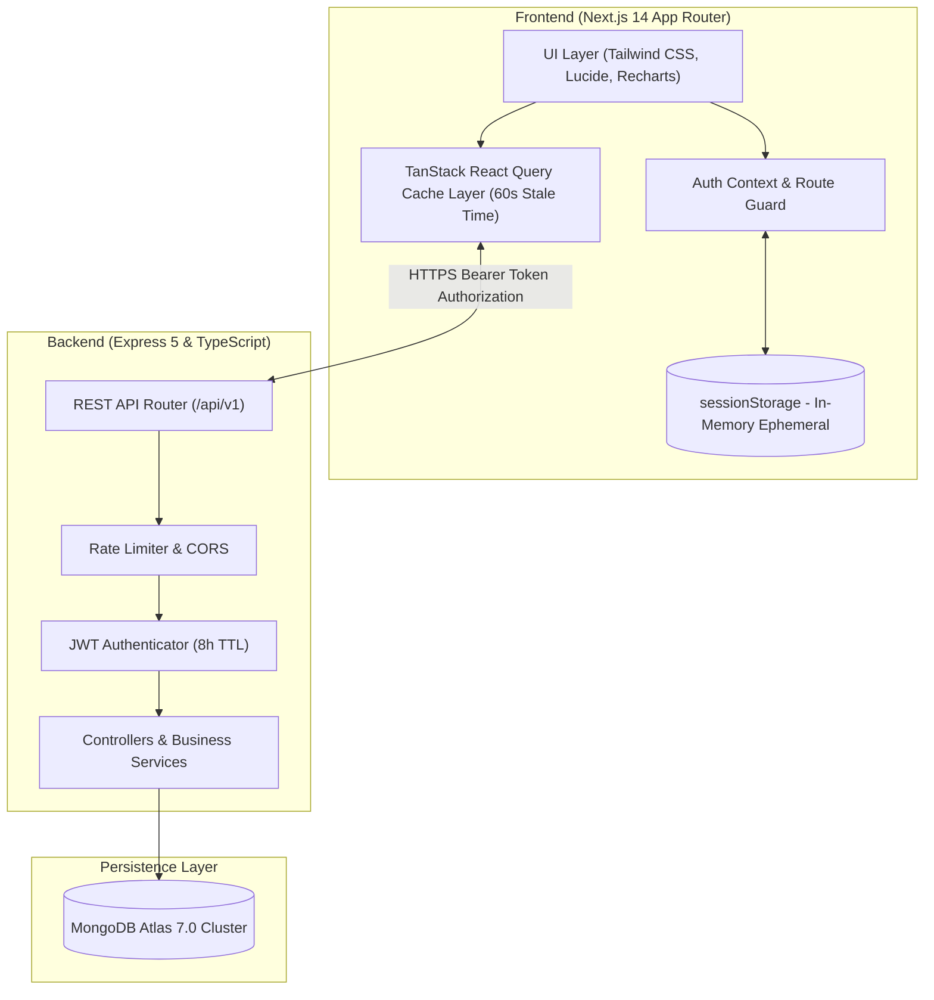

---

## 🧠 Technical Decisions

### Decision 1: TanStack React Query with Realtime Debouncing over Global State (Redux/Zustand)
- **Rationale**: For an administrative dashboard with frequent create, update, and delete actions across doctors and patients, server state differs significantly from client UI state.
- **Why React Query**: 
  - Eliminates boilerplate action creators, reducers, and manual loading/error flags.
  - Automatically handles cache invalidation (`queryClient.invalidateQueries`) across dependent entities (e.g. deleting or assigning a patient under a doctor immediately re-fetches both the doctor's patient count, assigned tables, and the dashboard analytics aggregations).
  - Custom `useDebounce` hook (300ms) coordinates live search typing with reactive backend MongoDB aggregation pipelines without flooding the server.
  - Responsive pagination displays immediate page state changes and replaces rows with skeleton loaders (`isLoading || isFetching`) during live transitions.

### Decision 2: Ephemeral `sessionStorage` JWT Storage over `localStorage`
- **Rationale**: Strict healthcare and clinical application security standards dictate that authentication tokens should never persist indefinitely on shared medical workstations.
- **Implementation**: 
  - Storing the JWT in `sessionStorage` guarantees that closing the browser tab or window immediately revokes the client session.
  - Paired with an 8-hour token expiration on the backend, this provides strong session boundary protection while ensuring medical administrators can navigate between tabs and perform daily tasks uninterrupted.

---

## 🔑 Default Admin Credentials

For evaluation and testing:
- **Email**: `admin@example.com`
- **Password**: `Admin@123`
*(A convenient "Auto-fill" button is provided directly on the `/login` portal screen)*

---

## 📸 Visual Evidence (UI Screenshots)

### 🖥️ Desktop Views

#### 1. Secure Medical Portal Login
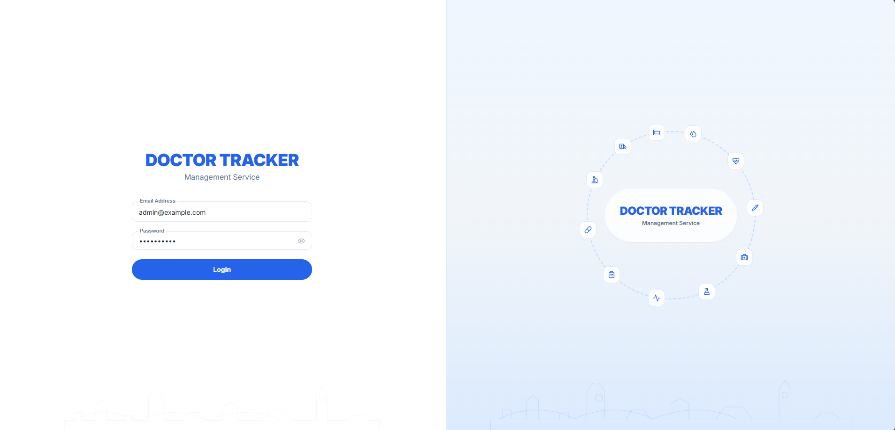
*Responsive login card with live service health probe (`backend is starting...`), input validation, and password visibility toggle.*

#### 2. Clinical Analytics Dashboard (Patient Intake & Trends)
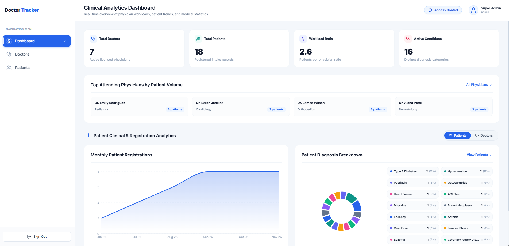
*Live overview metrics cards, Top Attending Physicians by Patient Volume, monthly registration trends, and diagnostic breakdown.*

#### 3. Clinical Analytics Dashboard (Physician Capacity & Workload)
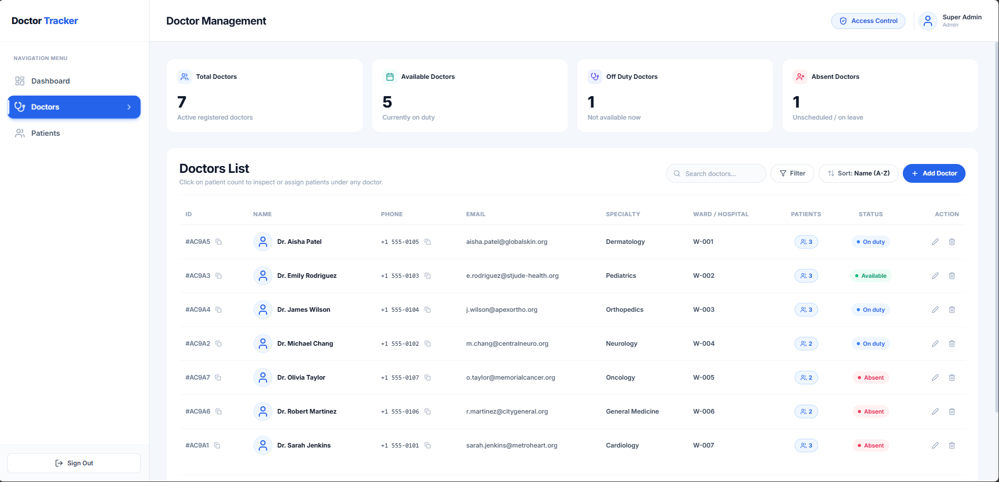
*Dedicated `[ Patients | Doctors ]` toggle revealing physician staffing capacity and workload analytics.*

#### 4. Doctors Management Directory
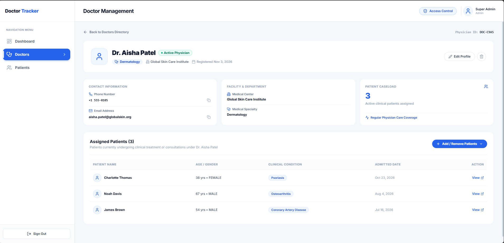
*Doctors table with live multi-field debounced search, specialization filtering, date range selector, and immediate skeleton page transitions.*

#### 5. Physician Profile & Patient Roster
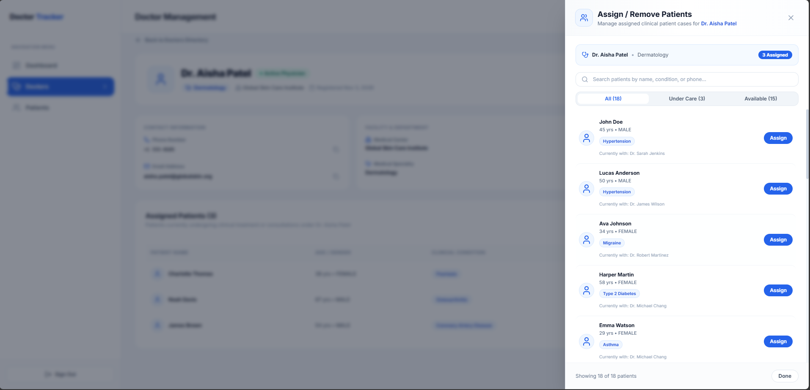
*Detailed physician profile (`/doctors/[id]`) displaying hospital affiliations, credentials, and assigned patient roster.*

#### 6. Patient Assignment Drawer (Slide-Over Drawer)
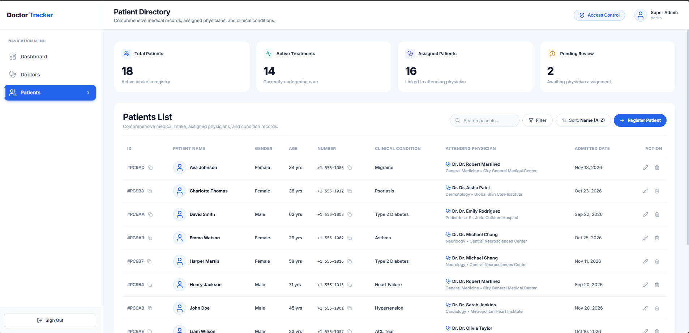
*Animated right slide-over drawer with full-page backdrop dimming. Instant 'Assign' and 'Remove' actions with confirmation popups.*

#### 7. Patients Management Directory
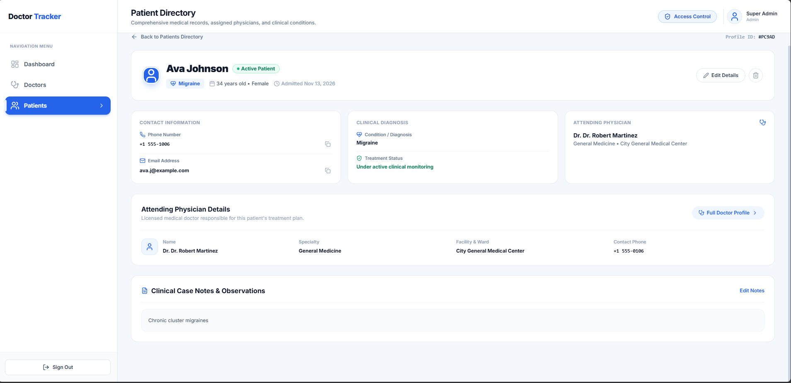
*Comprehensive patients table with debounced search, condition filtering, assigned doctor filtering, gender selector, and pagination.*

#### 8. Patient Intake & Registration Modal
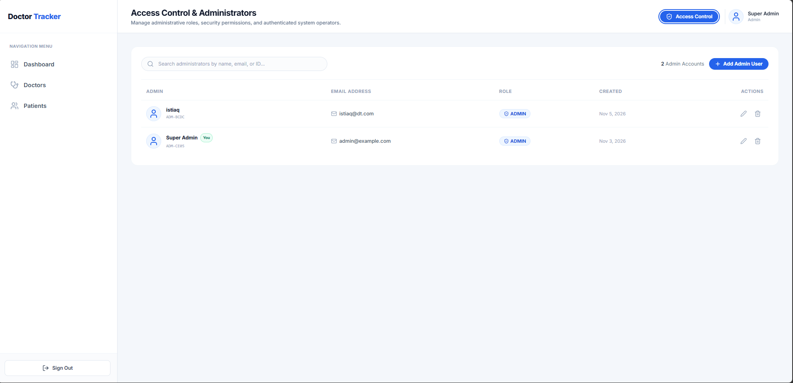
*Intake modal featuring full input validation, disease categorization, attending doctor assignment with lock mechanism, and clinical notes.*

#### 9. Access Control & Administrator Directory
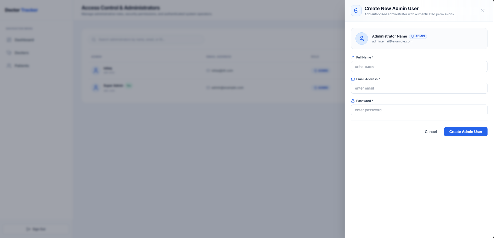
*Administrator directory with live account counter, search, copyable IDs, user DP avatars, and admin account management.*

---

### 📱 Mobile Views

#### 1. Mobile Login & Dashboard Overview
| Mobile Login | Mobile Dashboard Overview |
|:---:|:---:|
| 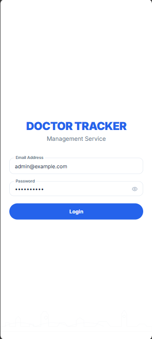 | 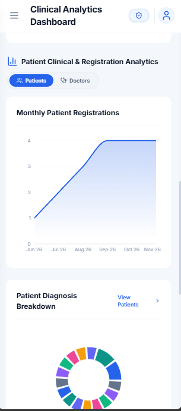 |
| *Fluid single-column authentication* | *Responsive metric cards & overview* |

#### 2. Mobile Visual Charts & Doctors Directory
| Mobile Analytics Charts | Mobile Doctors List |
|:---:|:---:|
| 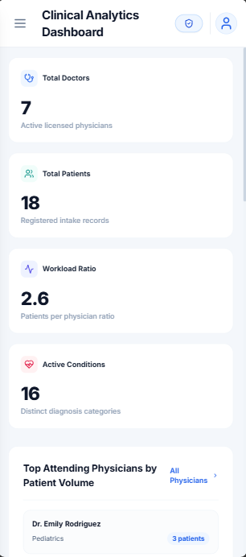 | 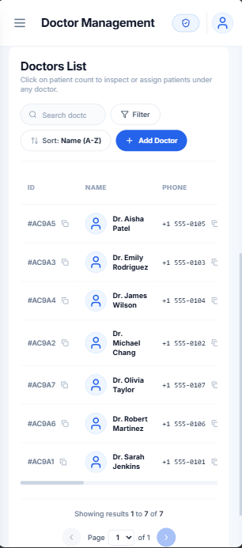 |
| *Touch-friendly responsive charts* | *Compact card layout with search* |

#### 3. Mobile Doctor Profile & Intake Action Sheet
| Mobile Doctor Profile | Mobile Bottom Sheet Drawer |
|:---:|:---:|
| 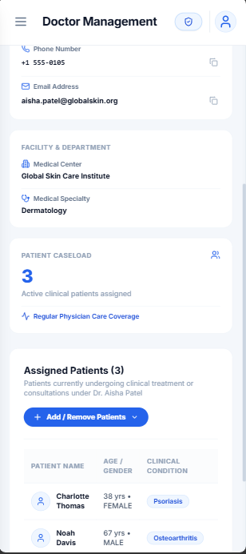 | 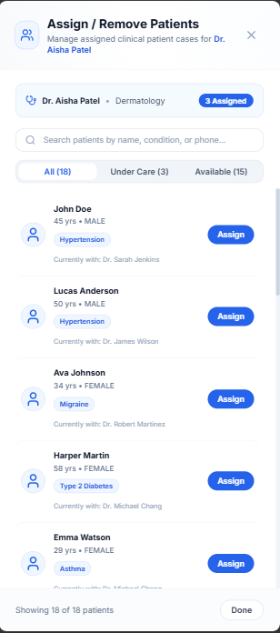 |
| *Physician overview and patients table* | *Native bottom sheet with touch handle* |

#### 4. Mobile Patients Directory & Intake Drawer
| Mobile Patients List | Mobile Patient Modal |
|:---:|:---:|
| 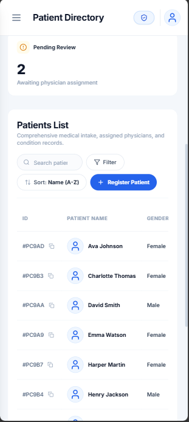 | 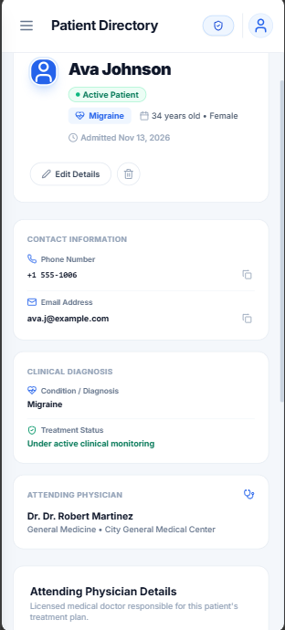 |
| *Patient roster with condition tags* | *Fullscreen mobile intake drawer* |

#### 5. Mobile Access Control & Administrator Form
| Mobile Access Control | Mobile Admin Create Modal |
|:---:|:---:|
| 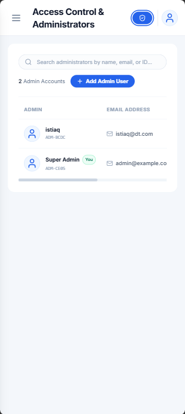 | 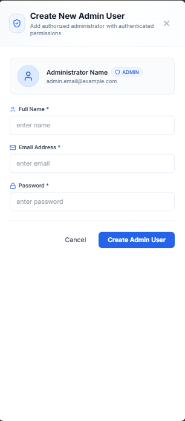 |
| *Administrator directory on mobile* | *Touch-friendly admin creation form* |
