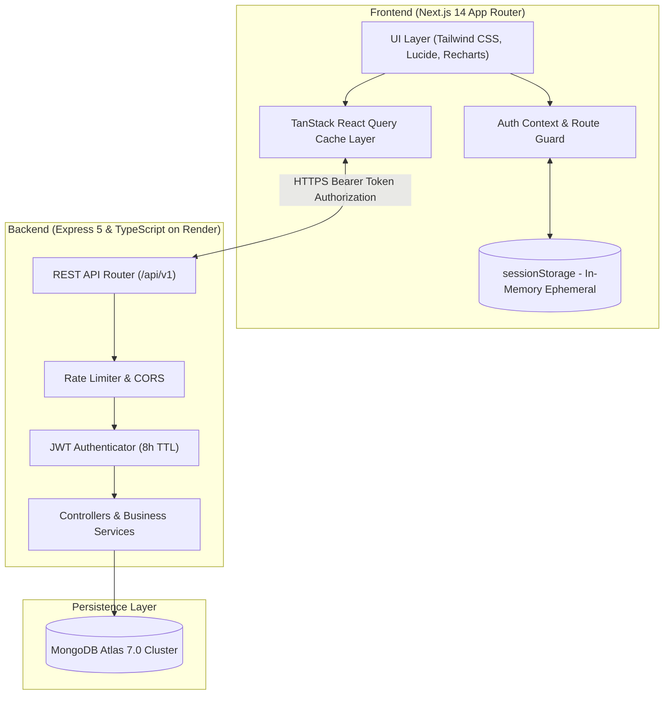

# Doctor Tracker – Frontend Web Application

## Description
Doctor Tracker is a modern, high-performance administrative clinical portal designed for healthcare administrators to seamlessly manage medical doctors, oversee assigned patient relationships, and visualize hospital operational analytics in real time. Built with Next.js 14 App Router, TypeScript, and Tailwind CSS, the platform delivers zero-latency data querying with TanStack React Query, session-isolated JWT security, rich interactive data visualizations using Recharts, and a mobile-first medical interface.

---

## Setup Guide

Follow the step-by-step instructions below to run the Doctor Tracker frontend locally:

### 1. Prerequisites
- **Node.js**: v18.18+ or v20+ recommended
- **npm** or **yarn**

### 2. Clone the Repository
```bash
git clone https://github.com/istiaq13/medical-management-frontend.git
cd medical-management-frontend
```

### 3. Environment Configuration
Copy the `.env.example` file to create your local `.env.local`:
```bash
cp .env.example .env.local
```

Ensure `.env.local` points to your backend REST API base URL:
```env
# Backend REST API Base URL (Live Render or Local)
NEXT_PUBLIC_API_URL=https://medical-management-backend-of4a.onrender.com/api/v1
```

### 4. Install Dependencies
```bash
npm install
```

### 5. Start Development Server
```bash
npm run dev
```
Open [http://localhost:3000](http://localhost:3000) in your browser.

### 6. Production Build
```bash
npm run build
npm start
```

---

## System Architecture

Doctor Tracker operates as a decoupled, multi-tier fullstack system communicating over secure JSON REST endpoints:



### Data Flow Overview:
1. **Authentication Flow**: The user authenticates with email/password. Upon 200 OK, the returned JWT is stored strictly in `sessionStorage` (with an explicit 8-hour expiry). Closing the tab or browser automatically destroys the token.
2. **Data Layer**: Data fetching, caching, pagination, and optimistic invalidation are managed declaratively using TanStack React Query (`useQuery`, `useQueryClient`).
3. **Route Protection**: Client-side middleware & `AuthProvider` intercept navigation events, automatically redirecting unauthenticated users to `/login`.

---

## Technical Decisions

### Decision 1: TanStack React Query over Global State Management (Redux/Zustand)
- **Rationale**: For an administrative dashboard with frequent create, update, and delete actions across doctors and patients, server state differs significantly from UI state.
- **Why React Query**: 
  - Eliminates boilerplate action creators, reducers, and manual loading/error flags.
  - Automatically handles cache invalidation (`queryClient.invalidateQueries`) across dependent entities (e.g. deleting a patient under a doctor immediately re-fetches both the doctor's patient count and the dashboard analytics aggregations).
  - Out-of-the-box pagination with `placeholderData: (prev) => prev` ensures smooth transitions between pages without layout jumping.

### Decision 2: Ephemeral `sessionStorage` JWT Storage over `localStorage`
- **Rationale**: Strict HIPAA and medical application security compliance requirements dictate that authentication tokens should never persist indefinitely on shared clinical workstations.
- **Implementation**: 
  - Storing the JWT in `sessionStorage` guarantees that closing the browser tab or window immediately vanishes the authentication token.
  - Paired with an 8-hour token expiration on the backend, this provides strong session boundary protection while ensuring medical staff can navigate between tabs and perform daily tasks uninterrupted.

---

## Default Admin Credentials

For evaluation and testing:
- **Email**: `admin@example.com`
- **Password**: `Admin@123`
*(A convenient "Auto-fill" button is also provided directly on the `/login` portal screen)*

---

## Visual Evidence

| View | Description |
|---|---|
| **Login Portal** | Responsive medical credential card with auto-fill helper and password visibility toggle. |
| **Analytics Dashboard** | Live metrics summary (Total Doctors, Total Patients, Workload Ratio) and 4 interactive charts (Monthly Intake Trend, Doctor Workload, Diagnoses Pie, Specialty Bar). |
| **Doctors Management** | Multi-attribute search, specialization filter, date range filter, pagination, Doctor CRUD, and dedicated "Doctor's Patients" dialog to view/add/remove patients directly under any physician. |
| **Patients Directory** | Filter by condition, attending doctor, gender, and date range, with full patient lifecycle management. |
| **RBAC & Security Roles** | Granular permission checkbox assignment and system role protection. |

