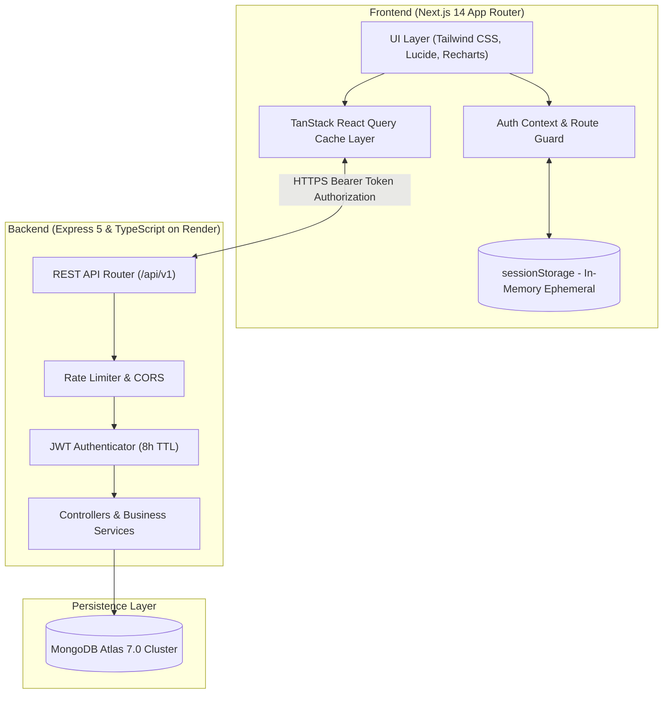

# Doctor Tracker – Frontend Web Application

## Description
Doctor Tracker is a modern, high-performance administrative clinical portal designed for healthcare administrators to seamlessly manage medical doctors, oversee assigned patient relationships, and visualize hospital operational analytics in real time. Built with Next.js 14 App Router, TypeScript, and Tailwind CSS, the platform delivers zero-latency data querying with TanStack React Query, session-isolated JWT security, rich interactive data visualizations using Recharts, and a mobile-first medical interface with responsive drawer workflows.

---

## Setup Guide

Follow the step-by-step instructions below to run the Doctor Tracker frontend locally:

### 1. Prerequisites
- **Node.js**: v18.18+ or v20+ recommended
- **npm** or **yarn**

### 2. Clone the Repository
```bash
git clone https://github.com/istiaq13/medical-management-frontend.git
cd medical-management-frontend
```

### 3. Environment Configuration
Copy the `.env.example` file to create your local `.env.local`:
```bash
cp .env.example .env.local
```

Ensure `.env.local` points to your backend REST API base URL:
```env
# Backend REST API Base URL (Live Render or Local)
NEXT_PUBLIC_API_URL=https://medical-management-backend-of4a.onrender.com/api/v1
```

### 4. Install Dependencies
```bash
npm install
```

### 5. Start Development Server
```bash
npm run dev
```
Open [http://localhost:3000](http://localhost:3000) in your browser.

### 6. Production Build
```bash
npm run build
npm start
```

---

## System Architecture

Doctor Tracker operates as a decoupled, multi-tier fullstack system communicating over secure JSON REST endpoints:



### Data Flow Overview:
1. **Authentication Flow**: The user authenticates with email/password. Upon 200 OK, the returned JWT is stored in `sessionStorage` (with an explicit 8-hour expiry). Closing the tab or browser automatically clears the session.
2. **Data Layer**: Data fetching, caching, real-time debounced querying, and optimistic cache invalidation are managed declaratively using TanStack React Query (`useQuery`, `useQueryClient`).
3. **Route Protection**: Client-side middleware & `AuthProvider` intercept navigation events, automatically redirecting unauthenticated users to `/login`.
4. **Immediate Transitions & Skeleton Loading**: Table pagination immediately transitions page counters and displays skeleton animated placeholders while new pages load from the backend.

---

## Technical Decisions

### Decision 1: TanStack React Query with Realtime Debouncing over Global State (Redux/Zustand)
- **Rationale**: For an administrative dashboard with frequent create, update, and delete actions across doctors and patients, server state differs significantly from client UI state.
- **Why React Query**: 
  - Eliminates boilerplate action creators, reducers, and manual loading/error flags.
  - Automatically handles cache invalidation (`queryClient.invalidateQueries`) across dependent entities (e.g. deleting or assigning a patient under a doctor immediately re-fetches both the doctor's patient count, assigned tables, and the dashboard analytics aggregations).
  - Custom `useDebounce` hook (300ms) coordinates live search typing with reactive backend MongoDB aggregation pipelines without flooding the server.
  - Responsive pagination displays immediate page state changes and replaces rows with skeleton loaders (`isLoading || isFetching`) during live transitions.

### Decision 2: Ephemeral `sessionStorage` JWT Storage over `localStorage`
- **Rationale**: Strict healthcare and clinical application security standards dictate that authentication tokens should never persist indefinitely on shared medical workstations.
- **Implementation**: 
  - Storing the JWT in `sessionStorage` guarantees that closing the browser tab or window immediately revokes the client session.
  - Paired with an 8-hour token expiration on the backend, this provides strong session boundary protection while ensuring medical administrators can navigate between tabs and perform daily tasks uninterrupted.

---

## Default Admin Credentials

For evaluation and testing:
- **Email**: `admin@example.com`
- **Password**: `Admin@123`
*(A convenient "Auto-fill" button is provided directly on the `/login` portal screen)*

---

## Features & UI Modules

| Module | Features & Capabilities |
|---|---|
| **Login Portal** | Responsive medical credential card with service health status check (`backend is starting...` feedback), auto-fill helper, password visibility toggle, and clear readable error toasts. |
| **Analytics Dashboard** | Overview stat cards (Total Doctors, Total Patients, Workload Ratio, Active Diagnoses), top attending physicians section, and visual graphs with dedicated `[ Patients \| Doctors ]` toggle switchers. |
| **Doctors Management** | Multi-attribute search, specialization filter, date range filter, instant pagination with skeletons, Doctor CRUD, and dedicated "Doctor's Patients" right slide-over drawer to view, assign, and remove patients under any physician. |
| **Doctor Profile Detail** | Dedicated `/doctors/[id]` page with attending credentials, assigned patients list, and responsive action menu with bottom-sheet drawer for mobile screens and anchored dropdown for desktop. |
| **Patients Directory** | Filter by clinical condition, attending doctor, gender, and admitted date range with debounced search and full patient lifecycle management. |
| **Access Control** | Clean full-width Administrator Directory with search, ID copy helpers, and quick modal creation (`enter name`, `enter email`, `enter password`) defaulting to ADMIN role. |
